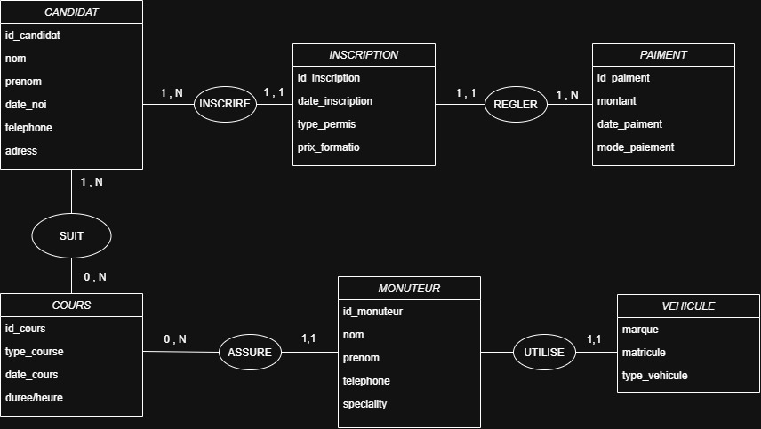
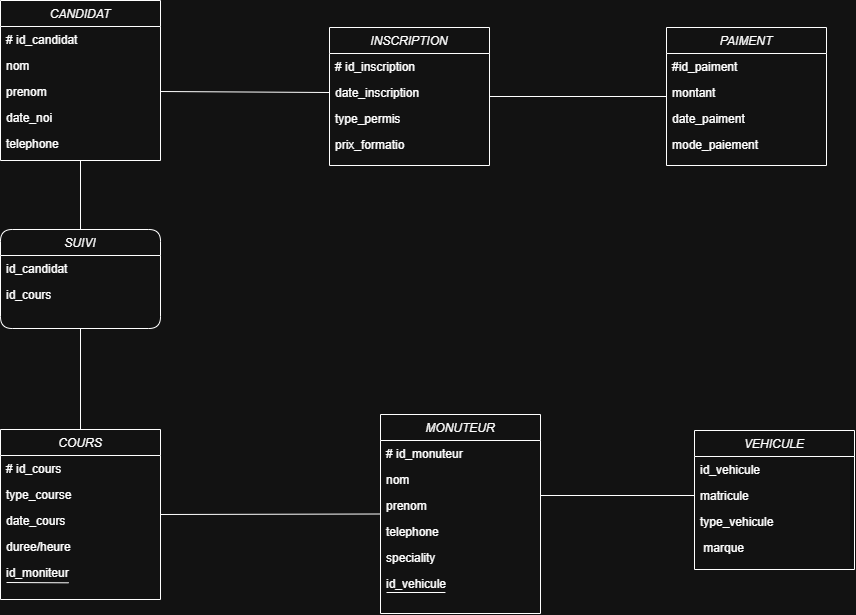

# auto-ecole
Application de gestion d'une auto-école développée en Python avec MySQL. Elle permet de gérer les candidats, les inscriptions, les moniteurs, les véhicules, les cours et les paiements.
<div align="center">
<div align="center">

# 🚗 Auto-École Al Manahil — Gestion de Base de Données

**Conception et réalisation d'un système de gestion complet pour l'Auto-école Al Manahil.**

[](https://mysql.com)
[](https://apachefriends.org)
[](https://visualstudio.com)
[]()

[📋 Cahier des Charges](#-cahier-des-charges--auto-école-al-manahil) • [🗄️ Modèles MCD & MLD](#-conception-de-la-base-de-données) • [🚀 Installation & Code](#-installation--code)

</div>

---

## 📋 Cahier des Charges — Auto-école Al Manahil

> [!NOTE]
> **1. Présentation du Projet**  
> Le projet consiste à concevoir et réaliser une base de données pour **l'auto-école Al Manahil**. Elle permet de centraliser et gérer les différentes activités de l'établissement : **candidats, inscriptions, moniteurs, véhicules, cours et paiements**.

###   2. Objectifs Principaux
*    **Candidats :** Faciliter la gestion et le suivi des dossiers.
*    **Inscriptions :** Organiser les inscriptions par type de permis.
*    **Moniteurs :** Gérer les informations et spécialités des moniteurs.
*    **Véhicules :** Assurer le suivi et l'état du parc automobile.
*    **Cours :** Planifier les séances théoriques et pratiques de conduite.
*    **Paiements :** Gérer les règlements et soldes restants des candidats.

---

### ⚙️ 3. Besoins Fonctionnels

| Domaine | Fonctionnalités Clés |
| :--- | :--- |
| **Candidats & Dossiers** | Ajouter, modifier, supprimer et consulter les dossiers complets des candidats. |
| **Inscriptions** | Enregistrer les nouvelles inscriptions avec le type de permis et le tarif. |
| **Ressources (Staff & Parc)** | Ajouter et gérer les moniteurs ainsi que les véhicules de l'auto-école. |
| **Planification des Cours** | Organiser les cours théoriques/pratiques et affecter **un moniteur** et **un véhicule** à chaque séance. |
| **Suivi Financier** | Enregistrer les paiements et consulter les montants payés et restants. |

---

###  4. Les Données à Gérer (6 Entités Principales)

| Entité | Attributs |
| :--- | :--- |
|  **Candidat**    | `Id_Candidat`, `Nom`, `Prénom`, `Date_Naissance`, `Téléphone`, `Adresse` |
|  **Inscription** | `Id_Inscription`, `Date_Inscription`, `Type_Permis`, `Prix_Formation`    |
| ‍ **Moniteur**    | `Id_Moniteur`, `Nom`, `Prénom`, `Téléphone`, `Spécialité`                |
|  **Véhicule**    | `Id_Vehicule`, `Marque`, `Matricule`, `Type_Vehicule`, `État`            |
|  **Cours**       | `Id_Cours`, `Type_Cours`, `Date_Cours`, `Heure`, `Durée`                 |
|  **Paiement**    | `Id_Paiement`, `Montant`, `Date_Paiement`, `Mode_Paiement`               |

---

### 📏 5. Règles de Gestion

* **Candidat ↔ Inscription :** Un candidat peut effectuer **une ou plusieurs** inscriptions ; chaque inscription appartient à **un seul** candidat.
* **Inscription ↔ Paiement :** Une inscription peut avoir **plusieurs** paiements ; chaque paiement appartient à **une seule** inscription.
* **Candidat ↔ Cours :** Un candidat peut suivre **plusieurs** cours, et un cours peut être suivi par **plusieurs** candidats.
* **Moniteur ↔ Cours :** Un moniteur peut assurer **plusieurs** cours ; chaque cours est assuré par **un seul** moniteur.
* **Véhicule ↔ Cours :** Un véhicule peut être utilisé dans **plusieurs** cours ; chaque cours utilise **un seul** véhicule.

---

### 🛠️ 6. Environnement Technique & Contraintes

> [!IMPORTANT]
> **Stack Technique :** `MySQL` (SGBD) • `XAMPP` (Serveur local) • `SQL` (Langage) • `VS Code` (Outil de gestion)

*   Utilisation stricte des **Clés Primaires (`PRIMARY KEY`)** et **Clés Étrangères (`FOREIGN KEY`)**.
*   Respect de l'intégrité référentielle et des cardinalités entre les tables.
*   Normalisation des données (éviter toute redondance) et garantie de la cohérence des informations.

###   7. Résultats Attendus
Une base de données relationnelle complète, fiable et structurée permettant à **l'auto-école Al Manahil** de piloter efficacement ses candidats, inscriptions, moniteurs, véhicules, cours et paiements.

> 📥 **[Télécharger le Cahier des Charges original (PDF)](./cahier_de_charge/cahier_de_charge.pdf)**

---

## 🗄️ Conception de la Base de Données

### 1. Modèle Conceptuel de Données (MCD)
<p align="center">
  
</p>

### 2. Modèle Logique de Données (MLD)
<p align="center">
  
</p>

---

## 🚀 Installation & Code

```bash
# 1. Cloner le dépôt
git clone https://github.com/ichrakzergani08-sketch/auto-ecole.git

# 2. Accéder au dossier du projet
cd auto-ecole

# 3. Importer le script SQL dans phpMyAdmin (XAMPP) ou MySQL
```


### Modèle Logique de Données (MLD)
<details>
<summary><b>🔍 Cliquer pour voir le MLD</b></summary>
<br>
<p align="center">
  
</p>
</details>

---

## 🚀 Installation & Code

```bash
git clone https://github.com
cd auto-ecole
python main.py
```
